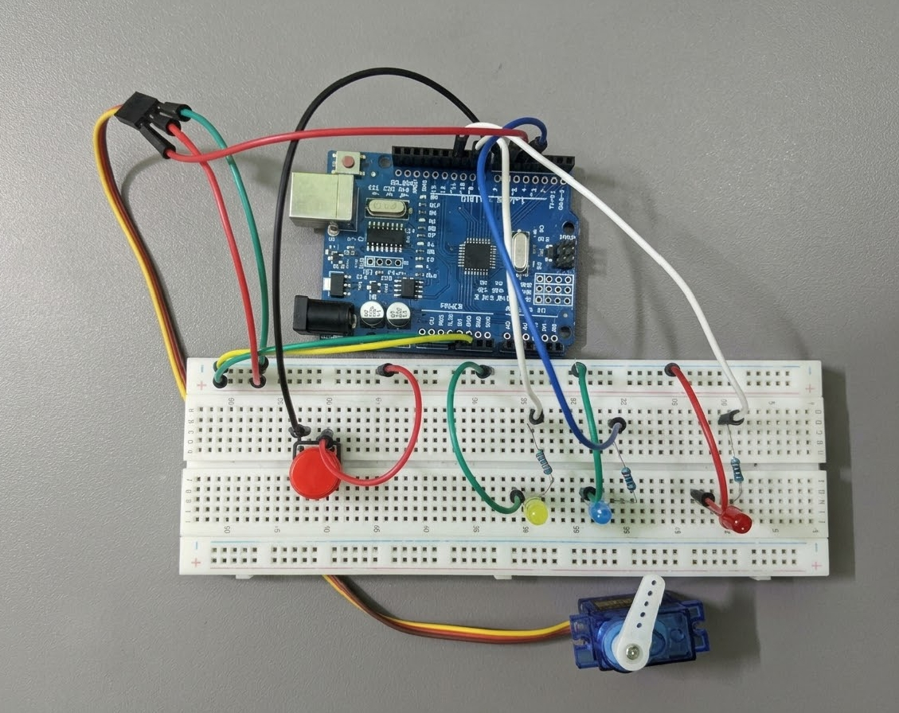
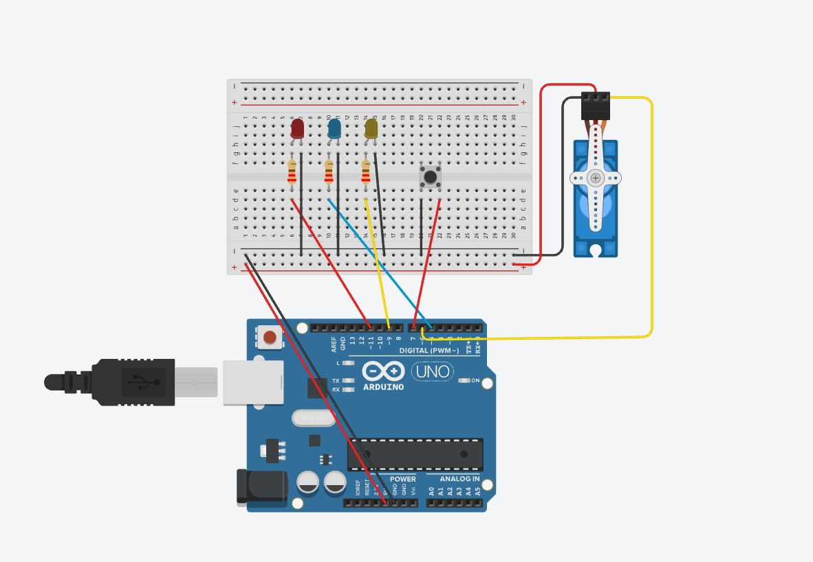

# Arduino-Millis-Multitasking
A beginner-friendly Arduino project that runs **four tasks at the same time** using `millis()` instead of `delay()`. It shows how non-blocking code lets an Arduino blink, fade, read a button, and move a servo all at once.



## Features

| Task | Component | Behavior |
|------|-----------|----------|
| 1 | Red LED | Blinks every 1 second |
| 2 | Blue LED | Fades smoothly up and down (PWM) |
| 3 | Yellow LED + push button | LED is ON while the button is held |
| 4 | Servo motor | Sweeps from 0° to 180° and back |

## Why `millis()` and not `delay()`?

`delay()` stops the whole program, so only one thing can happen at a time. With `millis()`, each task checks the clock and runs only when its interval has passed. The loop never waits, so every task keeps running smoothly.

```cpp
if (currentMillis - lastTime >= INTERVAL) {
  lastTime = currentMillis;
  // do the task
}
```

## Components

- Arduino Uno or Nano
- 3 LEDs (red, blue, yellow)
- 3 × 220Ω resistors
- 1 push button
- 1 servo motor (SG90 or similar)
- Breadboard and jumper wires

## Circuit Diagram



## Pin Connections

| Component | Arduino Pin | Notes |
|-----------|-------------|-------|
| Red LED | 11 | Through a 220Ω resistor to GND |
| Blue LED | 5 | PWM pin, through a 220Ω resistor to GND |
| Yellow LED | 9 | Through a 220Ω resistor to GND |
| Push button | 7 | Other leg to GND (uses `INPUT_PULLUP`) |
| Servo signal | 6 | Servo 5V and GND to 5V and GND |

> **Tip:** If the servo jitters or the board resets, power the servo from an external 5V supply and connect its GND to the Arduino GND.


## How to Run

1. Wire the circuit as shown in the pin table.
2. Open `Arduino-Millis-Multitasking.ino` in the Arduino IDE.
3. Select your board and port.
4. Click **Upload**.

The `Servo` library is built into the Arduino IDE, so no extra installation is needed.

## What I Learned

- Non-blocking multitasking with `millis()`
- PWM fading with `analogWrite()`
- Reading a button with `INPUT_PULLUP`
- Controlling a servo with the `Servo` library
- Splitting code into small, single-purpose functions

## Possible Improvements

- Add button debouncing and a toggle mode (press once = ON, press again = OFF)
- Control the servo speed with a potentiometer
- Replace the button with a sensor, such as an ultrasonic sensor

## License

This project is open source and available under the [MIT License](LICENSE).

## Author

**Digbijoy Chakroborty**
### Email: digbijoycb1908@gmail.com
